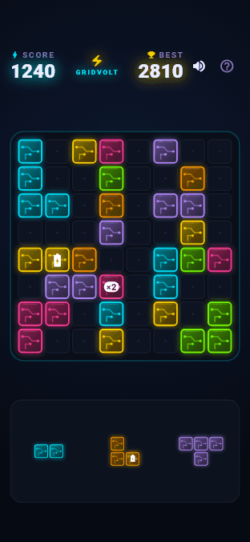
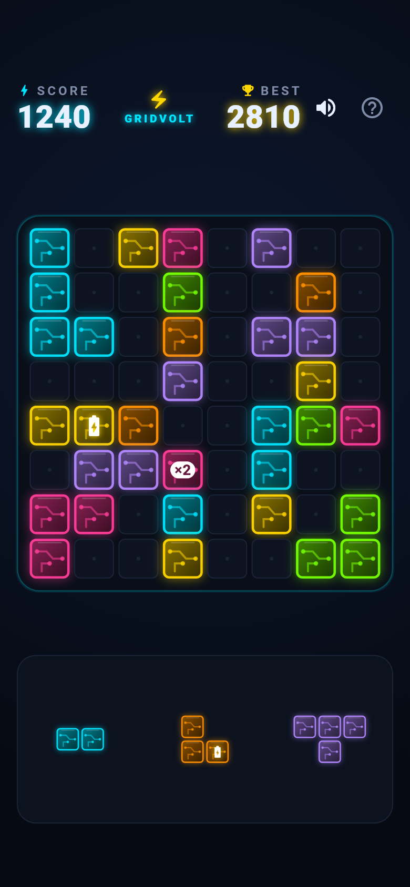
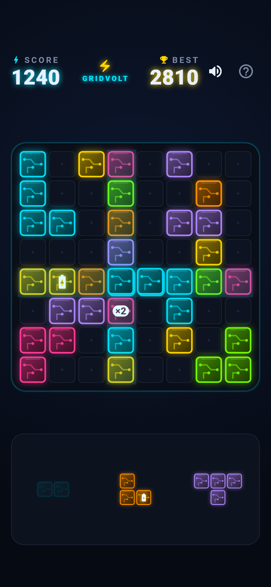
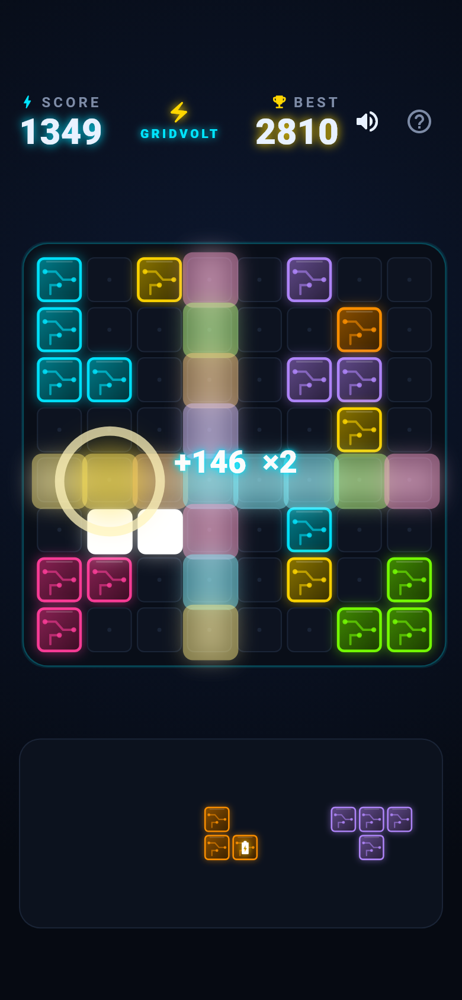
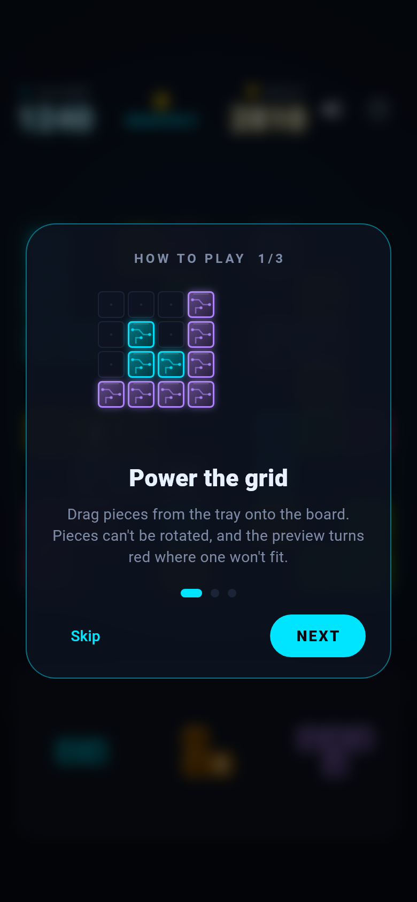
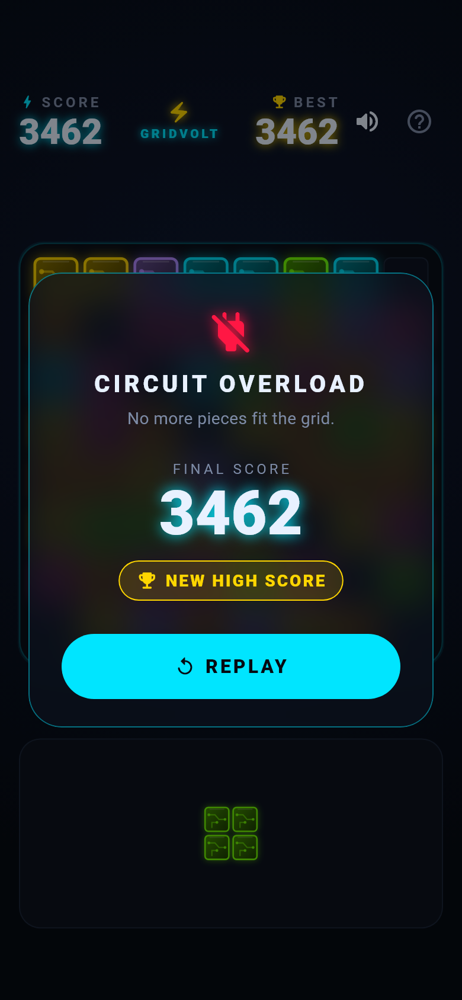

# GridVolt: Circuit Puzzle

[](https://github.com/abderrahmanTBD/GridVolt-Circuit-Puzzle/actions/workflows/main.yml)

A neon, dark-mode block-placement puzzle for Android and iOS. Drag circuit
pieces from the tray onto an 8 × 8 power grid; complete rows or columns to
discharge them. Built with Flutter, `flutter_bloc` and a pure-Dart rules engine.

<p align="center">
  
</p>

<p align="center">
  
  
  
</p>
<p align="center">
  
  
</p>

## Gameplay

- Three pieces are dealt at a time. A new set arrives once all three are placed.
- Fill a full row or column to clear it. Clearing several lines in one move
  scores a combo bonus (10 × lines²).
- **Battery tiles** 🔋 explode when cleared, wiping their 3 × 3 neighbourhood
  and chaining into any other battery caught in the blast.
- **Multiplier tiles** `×2` double the points of the move that clears them
  (they stack, up to ×8).
- Dealing is fair: every set contains at least one piece that fits, and smaller
  pieces become more likely as the board fills up.
- The game ends when none of the remaining pieces fits.
- A game in progress is saved after every move and resumes after a restart.
  The high score is kept forever.
- First launch shows a 3-step tutorial (reopen it with **?**). Special tiles
  get a one-time explanation the first time they appear.

## Architecture

```
lib/
├── domain/                 Pure Dart — no Flutter imports
│   ├── engine/             GridVoltEngine (rules, scoring), ShapeGenerator (fair dealing)
│   └── models/             GridCell, PuzzleShape, MoveResult, SpecialTile, palette
├── application/            State management
│   ├── game/               GameBloc + GameStateCodec (saves the run and high score)
│   ├── onboarding/         OnboardingCubit (tutorial and hints seen)
│   └── settings/           AudioSettingsCubit (persisted mute)
├── presentation/
│   ├── screens/            GameScreen + responsive layout
│   ├── widgets/            Board, tray, HUD, dialogs, tutorial, cells
│   ├── painters/           Circuit panels, placement preview, line-clear FX
│   ├── effects/            Sound effects (audioplayers)
│   └── theme/
├── app.dart                Providers + MaterialApp
└── main.dart               Storage + audio bootstrap
```

**Data flow:** tray `Draggable` → board-cell `DragTarget` → `PlaceShape` event →
`GridVoltEngine.applyMove` → new `GameState` → widgets rebuild. Animations and
sounds respond to `lastMoveResult` through `BlocListener`s.

**Drag precision.** The drag feedback is drawn at board scale and lifted above
the finger. `Draggable.feedbackOffset` aims the hit-test point at the centre of
the piece's top-left cell, so the cell under that point is the placement
origin. Drops that don't fit are rejected in `onWillAcceptWithDetails`, which
cancels the drag, and the piece flies back to its tray slot.

## Running

```bash
flutter pub get
flutter run
```

## Testing

| Command | What it covers |
| --- | --- |
| `flutter test` | Unit, widget and golden tests: engine scoring and surges, fair dealing, the bloc and save format, layout at 8 screen sizes, drag-and-drop, tutorial, Game Over dialog. Runs in CI on every push. |
| `flutter test integration_test -d <device>` | Plays a full game on a real device or emulator through the actual UI: tutorial → drag every piece → Game Over → Replay, with real audio. **Flutter uninstalls the app afterwards, wiping its saved data**, so use an emulator or a phone you don't mind resetting. Keep the screen on and don't touch it while it runs (about 1 minute). |
| `flutter test --update-goldens test/goldens` | Regenerates the golden images after an intentional visual change. |

Goldens use Flutter's test font (text renders as boxes) and a 1.5 % pixel
tolerance, so they match on Windows, macOS and Linux CI.

## Tooling

```bash
dart run tool/generate_sounds.dart   # synthesise the WAV sound effects
flutter test tool/readme_media       # render the README screenshots and GIF
```

Sound effects are generated procedurally, so the repo ships no third-party
audio. The README media is rendered from the real widgets with real fonts, so
it stays in sync with the UI.
